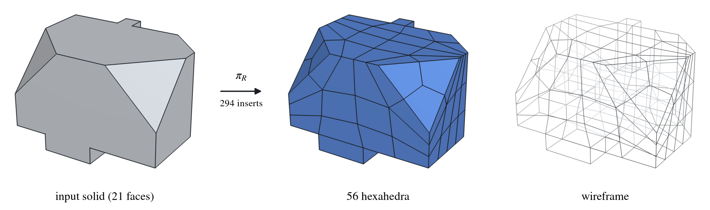

# HexIt: hexahedral block decomposition by expert iteration

Project page and (soon) code for **[HexIt: Learning Hexahedral Block Decomposition with Expert Iteration on
Combinatorial Maps](https://arxiv.org/abs/2611.10433)** (Arjun Narayanan and Per-Olof Persson, arXiv:2611.10433).

<p align="center"></p>

An agent that splits a 3D solid into hexahedral blocks one insert at a time (a vertex, an edge or a face), cloned from
decompositions that can be written down and then improved by expert iteration: it keeps its own successful
decompositions in a growing archive and retrains on them.

The code, trained models and evaluation sets will be released here.

## Citation

```bibtex
@misc{narayanan2026hexit,
  title         = {{HexIt}: Learning Hexahedral Block Decomposition with
                   Expert Iteration on Combinatorial Maps},
  author        = {Narayanan, Arjun and Persson, Per-Olof},
  year          = {2026},
  eprint        = {2611.10433},
  archivePrefix = {arXiv},
  primaryClass  = {cs.LG},
  url           = {https://arxiv.org/abs/2611.10433}
}
```

## Project page

`docs/` is the project page, served by GitHub Pages (Settings → Pages → deploy from branch `main`, folder `/docs`).
The gallery clips are in `docs/media/gallery/`.
